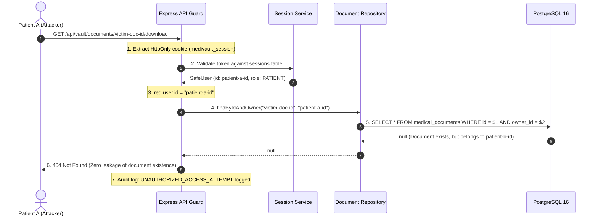

# MediVault AI — Document Access Control & Authorization Model (Revised)

**Document Version:** 2.0.0 (Post-Security Review Revisions)  
**Phase:** Phase 2C.2 Architecture & Planning  
**Classification:** Core Security Specification

---

## 1. Authorization Philosophy & Core Axioms

In healthcare architectures, Broken Object Level Authorization (BOLA / OWASP API1:2023) is the single most prevalent cause of catastrophic data exposure. MediVault AI enforces an uncompromising authorization policy:

1. **Patient Sovereignty:** A medical document is owned strictly by the authenticated patient (`ownerId`).
2. **Mandatory Server-Side Enforcement:** Every read, stream, metadata update, download, and deletion request verifies identity and ownership server-side.
3. **No Client-Asserted Ownership:** The backend never trusts or accepts an `ownerId`, `patientId`, or filesystem path from request bodies, headers, or query parameters.
4. **Information-Free Denials:** Unauthorized requests return **HTTP `404 Not Found`** instead of `403 Forbidden`, preventing attackers from enumerating the existence of document IDs belonging to other patients.

---

## 2. Server-Side Ownership Enforcement Architecture



### 2.1 Complete Endpoint Access Matrix

| Endpoint                            | HTTP Method | Required Role | Ownership Guard Condition                               | Unauthorized Response   |
| ----------------------------------- | ----------- | ------------- | ------------------------------------------------------- | ----------------------- |
| `/api/vault/documents`              | `GET`       | `PATIENT`     | `WHERE ownerId = req.user.id AND deletedAt IS NULL`     | Returns empty list `[]` |
| `/api/vault/documents/:id`          | `GET`       | `PATIENT`     | `WHERE id = :id AND ownerId = req.user.id`              | `404 Not Found`         |
| `/api/vault/documents/:id/preview`  | `GET`       | `PATIENT`     | `WHERE id = :id AND ownerId = req.user.id`              | `404 Not Found`         |
| `/api/vault/documents/:id/download` | `GET`       | `PATIENT`     | `WHERE id = :id AND ownerId = req.user.id`              | `404 Not Found`         |
| `/api/vault/documents/:id`          | `PATCH`     | `PATIENT`     | `WHERE id = :id AND ownerId = req.user.id`              | `404 Not Found`         |
| `/api/vault/documents/:id`          | `DELETE`    | `PATIENT`     | `WHERE id = :id AND ownerId = req.user.id`              | `404 Not Found`         |
| `/api/vault/upload`                 | `POST`      | `PATIENT`     | Implicit: Document created with `ownerId = req.user.id` | `401 / 403`             |

---

## 3. Analysis of PostgreSQL Row-Level Security (RLS) with Prisma

PostgreSQL Row-Level Security (RLS) enables the database engine to enforce access policies directly on table rows:

```sql
CREATE POLICY patient_document_isolation ON medical_documents
  FOR ALL
  USING (owner_id = current_setting('app.current_user_id', true));
```

### 3.1 Technical Assessment: Prisma ORM Connection Pooling vs. RLS

While RLS provides defense-in-depth, its integration with Node.js and Prisma presents concrete architectural risks:

1. **Connection Pooling Re-use:**
   Prisma maintains a pool of persistent TCP connections to PostgreSQL as a single database superuser/application user (`medivault_dev`).
2. **Session Context Bleed Risk:**
   Setting session context via `SET LOCAL app.current_user_id = 'user-123'` requires wrapping every single query in an interactive transaction (`prisma.$transaction`). If a connection is recycled without clearing session variables, requests could inherit the identity of a previous user.
3. **Transaction Overhead:**
   Enforcing interactive transactions for simple read queries introduces round-trip latency and connection pool exhaustion under high concurrency.

### 3.2 Decision & Strategy

- **Primary Enforcement Layer:** **Application-Level Repository Isolation (Mandatory & Tested).** Every Prisma query in the repository layer strictly requires `ownerId: req.user.id`.
- **Database RLS Schema Defense-in-Depth:** RLS policies are documented and prepared for enterprise production deployments using Prisma client extensions with transaction-bound `SET LOCAL`, but are **not** enabled on the local dev database in Phase 2C to preserve connection pool stability.

---

## 4. Planned Phase 3 Access Extensions: Family & Caregivers

### 4.1 Family Sharing Authorization Model (Planned Phase 3)

Family members will access documents exclusively through explicit, time-bounded permission grants:

- **No Global Account Delegation:** A family member never logs in as the patient. They log in with their own authenticated account.
- **Document-Level Permission Table (`DocumentShare`):**
  - `documentId`: Foreign key to `MedicalDocument`.
  - `sharedWithUserId`: Foreign key to `User`.
  - `permission`: `VIEW_FULL`, `VIEW_SUMMARY_ONLY`.
  - `expiresAt`: Automatic expiration timestamp.
  - `revokedAt`: Instant revocation timestamp.
- **Authorization Resolution:**
  ```sql
  WHERE (doc.owner_id = :userId)
     OR EXISTS (
       SELECT 1 FROM document_shares ds
       WHERE ds.document_id = doc.id
         AND ds.shared_with_user_id = :userId
         AND ds.revoked_at IS NULL
         AND ds.expires_at > NOW()
     )
  ```

### 4.2 Caregiver Non-Medical Boundary (Strict Security Wall)

In MediVault AI, **caregivers are strictly non-medical support companions** (e.g., assisting with mobility, daily companionship, or non-medical routines):

1. **Zero Clinical Access:** Caregivers have **no access** to raw medical documents, radiographs, laboratory reports, or prescriptions.
2. **Verification does NOT Authorize Records:** A verified caregiver badge confirms background vetting for physical companionship, but grants zero implicit medical document access.
3. **Scoped Caregiver Dashboard:** Caregivers can view only explicit non-clinical reminders (e.g. "Drink water", "Physical therapy at 10:00 AM"), never clinical findings.
