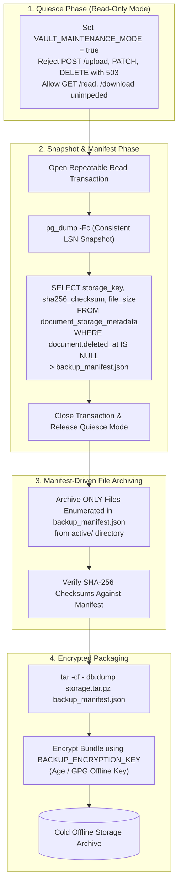
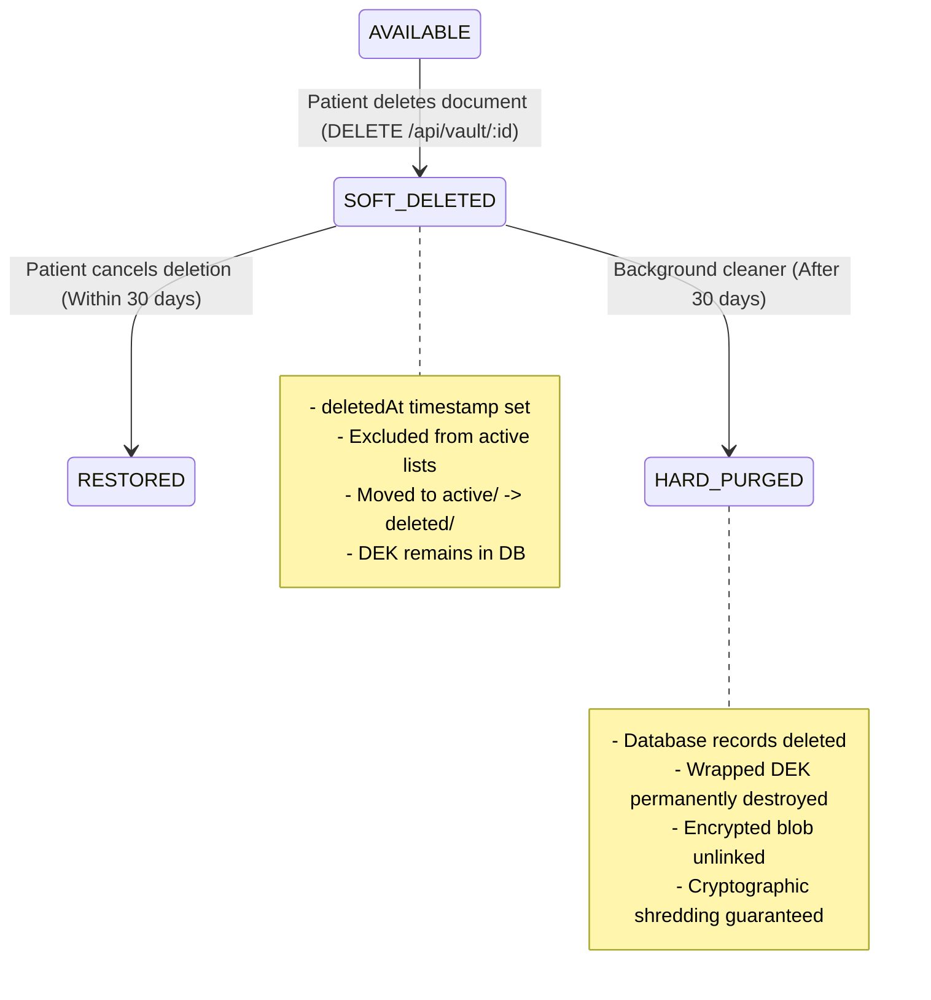

# MediVault AI — Backup, Disaster Recovery & Deletion Lifecycle (Revised)

**Document Version:** 2.0.0 (Post-Security Review Revisions)  
**Phase:** Phase 2C.2 Architecture & Planning  
**Classification:** Operational Security & Business Continuity  

---

## 1. Dual-Component Backup Architecture & Consistency Problem

MediVault AI's storage model consists of two tightly coupled components:
1. **Relational Database (PostgreSQL 16):** Stores patient records, document metadata, audit logs, and wrapped Data Encryption Keys (DEKs).
2. **Encrypted Storage Volume (`VAULT_STORAGE_ROOT`):** Stores raw AES-256-GCM encrypted file blobs (`.enc`).

### 1.1 The Fallacy of Simultaneous Backup
> [!CRITICAL]
> **Architectural Critique Addressed:** Running `pg_dump` and `tar` simultaneously does **not** guarantee transactional synchronization.
> - `pg_dump` takes a point-in-time relational snapshot at database timestamp $T_1$.
> - `tar` or file copying copies directory files over time interval $T_1 \to T_2$.
> - Any upload, deletion, or metadata edit occurring during this window causes inconsistencies:
>   - **Orphaned Blobs:** A file is archived by `tar`, but its DB transaction rolled back or was committed after $T_1$.
>   - **Missing Blobs:** The database snapshot contains records for files uploaded after $T_1$ that `tar` missed or that were deleted midway.

---

## 2. Redesigned Consistent Backup Boundary & Manifest Protocol

To achieve true transactional synchronization between PostgreSQL metadata and physical storage blobs, MediVault AI implements a **Quiesced Manifest Backup Protocol**:



### 2.1 The 4 Backup Protocol Steps

#### Step 1: Quiesce Mode (Read-Only Window)
Prior to snapshotting, the backup orchestrator signals the backend to enter maintenance mode:
- Uploads and deletions return HTTP `503 Service Unavailable` with `Retry-After: 60`.
- Active document reads and downloads continue without disruption.

#### Step 2: Consistent Database Snapshot & Manifest Generation
Inside a PostgreSQL repeatable-read transaction:
```bash
# Export consistent database dump
docker exec -t medivault-postgres pg_dump -U postgres -d medivault_dev -Fc -f /backup/db_snapshot.dump

# Extract exact ground-truth manifest matching the database snapshot
docker exec -t medivault-postgres psql -U postgres -d medivault_dev -t -A -F"," \
  -c "SELECT m.storage_key, s.sha256_checksum, m.file_size FROM medical_documents m JOIN document_storage_metadata s ON m.id = s.document_id WHERE m.deleted_at IS NULL;" \
  > /backup/manifest.csv
```

#### Step 3: Manifest-Driven Blob Archiving
The archive utility reads `manifest.csv` and copies **strictly the files enumerated in the manifest**:
```bash
tar -czf /backup/storage_snapshot.tar.gz -T <(cut -d, -f1 /backup/manifest.csv | awk '{print "active/"substr($1,1,2)"/"substr($1,3,2)"/"$1".enc"}') -C "$VAULT_STORAGE_ROOT"
```
Any files uploaded after the snapshot or pending staging files are excluded.

#### Step 4: Backup Encryption & Checksums
The bundle is cryptographically sealed with an independent offline administrative key:
```bash
sha256sum db_snapshot.dump storage_snapshot.tar.gz manifest.csv > manifest.sha256
tar -cf - db_snapshot.dump storage_snapshot.tar.gz manifest.csv manifest.sha256 | age -r age1admin... > medivault_backup_$(date +%Y%m%d_%H%M%S).tar.age
```

---

## 3. Database / Storage Reconciliation Utility (`vault:reconcile`)

An automated administrative script reconciles database records against physical storage:

```typescript
export async function reconcileVault(
  prisma: PrismaClient,
  storageService: IStorageService
): Promise<{
  activeCount: number;
  orphansCount: number;
  missingCount: number;
}> {
  // 1. Fetch all active storage keys from DB
  const dbDocs = await prisma.medicalDocument.findMany({
    where: { deletedAt: null },
    select: { storageKey: true, id: true },
  });
  const expectedKeys = new Set(dbDocs.map((d) => d.storageKey));

  // 2. Scan physical storage volume
  const { orphaned, missing } = await storageService.reconcileStorage(expectedKeys);

  // 3. Handle orphaned blobs (files on disk with zero DB reference)
  for (const orphanKey of orphaned) {
    // Quarantine orphan to prevent data loss before investigation
    await storageService.quarantineOrphan(orphanKey);
  }

  // 4. Handle missing blobs (DB record exists, but file is missing from disk)
  for (const missingKey of missing) {
    await prisma.medicalDocument.update({
      where: { storageKey: missingKey },
      data: { processingStatus: 'REJECTED' },
    });
    await prisma.documentAuditEvent.create({
      data: {
        action: 'STORAGE_BLOB_MISSING_ALERT',
        outcome: 'FAILED',
        actorId: 'SYSTEM_RECONCILER',
      },
    });
  }

  return { activeCount: expectedKeys.size, orphansCount: orphaned.length, missingCount: missing.length };
}
```

---

## 4. Disaster Recovery & Restoration Runbook

### Prerequisites for Recovery:
1. Encrypted backup bundle (`medivault_backup_*.tar.age`).
2. Administrative decryption key (`admin.key`).
3. Master Key Encryption Key (`VAULT_MASTER_KEY`) matching the backup's `keyVersion`.
4. Clean Docker environment with PostgreSQL 16 container.

### Step-by-Step Restoration Procedure:
```bash
# 1. Decrypt backup archive
age -d -i admin.key medivault_backup_20261031.tar.age | tar -xf -

# 2. Verify integrity manifest
sha256sum -c manifest.sha256

# 3. Restore PostgreSQL Database
docker exec -i medivault-postgres pg_restore -U postgres -d medivault_dev --clean --if-exists < db_snapshot.dump

# 4. Restore Encrypted Storage Blobs
tar -xzf storage_snapshot.tar.gz -C "$VAULT_STORAGE_ROOT"

# 5. Execute Reconciliation Script
npm run vault:reconcile
```

---

## 5. Document Deletion Lifecycle & Backup Privacy Limitations

MediVault AI implements a **two-tier deletion lifecycle**:



### 5.1 Soft Deletion (Immediate User Experience)
When a patient clicks "Delete" and confirms:
1. `MedicalDocument.deletedAt` is set to `now()`.
2. Document is immediately hidden from `/patient/vault` and all patient dashboard counts.
3. The file blob is moved from `active/` to `deleted/`.
4. The patient has a 30-day grace window to request restoration.

### 5.2 Hard Purge & Cryptographic Shredding
After 30 days, an automated maintenance worker permanently purges the record:
1. Delete `DocumentStorageMetadata` and `MedicalDocument` from PostgreSQL.
2. The wrapped DEK is destroyed. **This achieves cryptographic shredding**: even if the ciphertext blob was somehow retained on flash storage or historical backup snapshots, it is now mathematically impossible to decrypt.
3. The storage file blob in `deleted/` is unlinked.

### 5.3 Honest Disclosure on Backup Retention Limitations
> [!WARNING]
> **Backup Retention Boundary:** When a patient permanently deletes a document, live database records and physical storage files are eradicated immediately. However, **historical backup snapshots taken prior to deletion still contain copies of the encrypted blob and wrapped DEK**. 
> 
> In accordance with healthcare data engineering standards, permanent deletion guarantees apply to **live and operational storage immediately**, while complete eradication across backups occurs naturally as rolling backup snapshots age out of the 30-day retention window.
