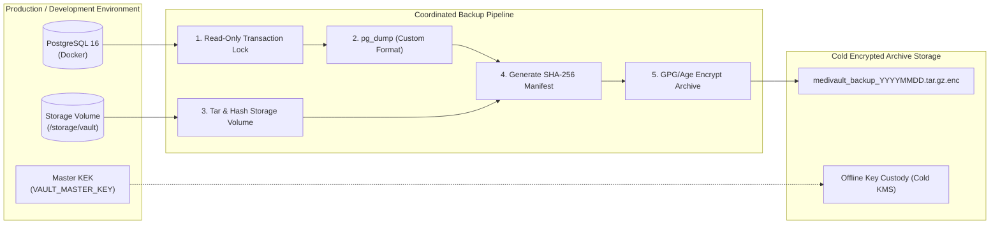

# MediVault AI — Backup, Disaster Recovery & Deletion Lifecycle

**Document Version:** 1.0.0  
**Phase:** Phase 2C.2 Architecture & Planning  
**Classification:** Operational Security & Business Continuity  

---

## 1. Dual-Component Backup Architecture

MediVault AI's storage model consists of two tightly coupled components:
1. **Relational Database (PostgreSQL 16):** Stores patient records, document metadata, audit logs, and wrapped Data Encryption Keys (DEKs).
2. **Encrypted Storage Volume (`medivault_vault_data`):** Stores raw AES-256-GCM encrypted file blobs (`.enc`).

Neither component is useful without the other. Restoring a database without the file volume results in missing blobs; restoring the file volume without the database results in unreadable ciphertext whose decryption keys are permanently lost.



---

## 2. Coordinated Snapshot Protocol

To ensure 100% transactional consistency between database rows and filesystem blobs:

### Step 1: Snapshot Coordination
1. Initiate backup job during maintenance or low-traffic window.
2. Establish read transaction in PostgreSQL:
   ```bash
   docker exec -t medivault-postgres pg_dump -U postgres -d medivault_dev -Fc -f /backup/db_snapshot.dump
   ```
3. Archive storage volume while preserving directory hierarchy and timestamps:
   ```bash
   tar -czf /backup/storage_snapshot.tar.gz -C /var/lib/medivault/storage/ active/ deleted/
   ```

### Step 2: Integrity & Checksum Manifest
Generate an immutable manifest verifying both components:
```bash
sha256sum db_snapshot.dump storage_snapshot.tar.gz > manifest.sha256
```

### Step 3: Backup Encryption at Rest
Encrypt the backup bundle using a dedicated offline administrative key (e.g. `age` or `GPG`):
```bash
tar -cf - db_snapshot.dump storage_snapshot.tar.gz manifest.sha256 | age -r age1admin... > medivault_backup_$(date +%Y%m%d_%H%M%S).tar.age
```

---

## 3. Disaster Recovery & Restoration Runbook

### Prerequisites for Recovery:
1. Valid encrypted backup bundle (`medivault_backup_*.tar.age`).
2. Administrative decryption key for the backup archive.
3. Master Key Encryption Key (`VAULT_MASTER_KEY`) matching the backup's `keyVersion`.
4. Clean Docker environment with PostgreSQL 16 container.

### Step-by-Step Restoration Procedure:
```bash
# 1. Decrypt backup archive
age -d -i admin.key medivault_backup_20261031.tar.age | tar -xf -

# 2. Verify SHA-256 checksums
sha256sum -c manifest.sha256

# 3. Restore PostgreSQL Database
docker exec -i medivault-postgres pg_restore -U postgres -d medivault_dev --clean --if-exists < db_snapshot.dump

# 4. Restore Encrypted Storage Blobs
tar -xzf storage_snapshot.tar.gz -C /var/lib/medivault/storage/

# 5. Fix POSIX Permissions
chmod -R 0700 /var/lib/medivault/storage/
find /var/lib/medivault/storage/ -type f -exec chmod 0600 {} +

# 6. Run Integrity Check Script
npm run vault:verify-integrity
```

---

## 4. Document Deletion Lifecycle & Backup Privacy Limitations

MediVault AI implements a **two-tier deletion lifecycle**:


### 4.1 Soft Deletion (Immediate User Experience)
When a patient clicks "Delete" and confirms:
1. `MedicalDocument.deletedAt` is set to `now()`.
2. Document is immediately hidden from `/patient/vault` and all patient dashboard counts.
3. The file blob is moved from `/storage/vault/active/` to `/storage/vault/deleted/`.
4. The patient has a 30-day grace window to request restoration.

### 4.2 Hard Purge & Cryptographic Shredding
After 30 days, an automated maintenance worker permanently purges the record:
1. Delete `DocumentStorageMetadata` and `MedicalDocument` from PostgreSQL.
2. The wrapped DEK is destroyed. **This achieves cryptographic shredding**: even if the ciphertext blob was somehow retained, it is now mathematically impossible to decrypt.
3. The storage file blob in `/deleted/` is overwritten with random bytes and unlinked.

### 4.3 Honest Disclosure on Backup Retention Limitations
> [!WARNING]
> **Backup Retention Boundary:** When a patient permanently deletes a document, MediVault AI purges the live database record and physical storage file. However, **historical backup snapshots taken prior to deletion still contain copies of the encrypted blob and wrapped DEK**. 
> 
> In accordance with healthcare data engineering standards, permanent deletion guarantees apply to **live and operational storage immediately**, while complete eradication across backups occurs naturally as rolling backup snapshots age out of the 30-day retention window. We never make false promises of instantaneous historical backup eradication.

---

## 5. Compromised Key Rotation Runbook

If the Master Key (`VAULT_MASTER_KEY`) is suspected of compromise:
1. Generate `NEW_MASTER_KEY`:
   ```bash
   node -e "console.log(crypto.randomBytes(32).toString('hex'))"
   ```
2. Execute the re-wrapping migration utility:
   ```bash
   VAULT_OLD_MASTER_KEY=old_hex VAULT_MASTER_KEY=new_hex npm run vault:rotate-kek
   ```
3. The utility:
   - Iterates through all rows in `DocumentStorageMetadata`.
   - Unwraps each DEK using `VAULT_OLD_MASTER_KEY`.
   - Re-wraps each DEK using `VAULT_MASTER_KEY`.
   - Updates `keyVersion = 2`.
4. Update production environment variables and restart backend.
5. Invalidate and purge old backup snapshots.
