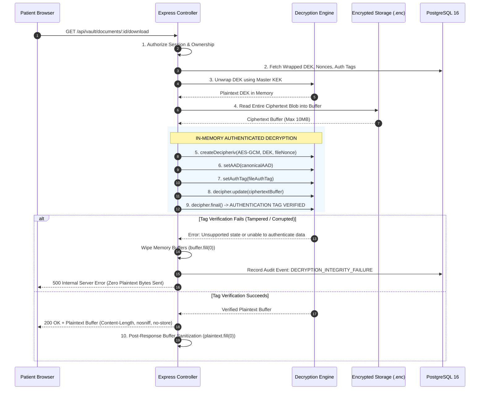

# MediVault AI — Encryption & Key Management Architecture (Revised)

**Document Version:** 2.0.0 (Post-Security Review Revisions)  
**Specification:** AES-256-GCM Envelope Encryption & Cryptographic Lifecycle  
**Classification:** Core Cryptographic Architecture

---

## 1. Cryptographic Principles & Authenticated Decryption Redesign

### 1.1 The Vulnerability of Streaming AES-GCM Plaintext

In Galois/Counter Mode (GCM), ciphertext blocks can technically be decrypted as they arrive in a stream. However, **the authentication tag is only evaluated at the very end of the stream** when `decipher.final()` is invoked.

Streaming unverified plaintext directly to an HTTP response means:

- If ciphertext has been tampered with, truncated, or forged, the client receives tampered plaintext bytes _before_ the server discovers the authenticity violation.
- This invalidates the primary security guarantee of Authenticated Encryption (AEAD) and opens side-channel attack vectors.

### 1.2 The Fix: Verify-Before-Release (In-Memory Authenticated Decryption)

Because MediVault AI enforces an initial document size limit of **10 MB**, the backend implements a strict **Verify-Before-Release** architecture:



### 1.3 Decryption Concurrency & Memory Safety

To prevent denial-of-service through memory exhaustion (e.g., 20 simultaneous 10 MB decryptions = 200 MB+ V8 heap spike):

1. **Concurrency Limiter:** Decryption requests are throttled using an in-process semaphore:
   $$\text{MAX\_CONCURRENT\_DECRYPTIONS} = 5$$
2. Excess requests wait in a prioritized queue with a 10-second timeout or return `429 Too Many Requests`.
3. **Explicit Memory Scrubbing:** Immediately upon completing `res.end()`, all transient Buffer references (`plaintextBuffer.fill(0)`) are zeroed out before being unreferenced for garbage collection.

---

## 2. Cryptographic Parameters & Key Specification

| Parameter                     | Value / Algorithm         | Cryptographic Rationale                                         |
| ----------------------------- | ------------------------- | --------------------------------------------------------------- |
| **Cipher**                    | `aes-256-gcm`             | AEAD cipher providing confidentiality and ciphertext integrity. |
| **Data Encryption Key (DEK)** | 256 bits (32 bytes)       | Generated uniquely per document via `crypto.randomBytes(32)`.   |
| **Master Key (KEK)**          | 256 bits (32 bytes)       | Stored exclusively in memory/env; wraps per-document DEKs.      |
| **File Nonce (IV)**           | 96 bits (12 bytes)        | Unique per document via `crypto.randomBytes(12)`.               |
| **DEK Nonce (IV)**            | 96 bits (12 bytes)        | Unique per DEK-wrapping operation via `crypto.randomBytes(12)`. |
| **Authentication Tag**        | 128 bits (16 bytes)       | Standard GCM tag length providing $2^{128}$ forgery resistance. |
| **Canonical AAD**             | Binary canonical encoding | Binds `documentId`, `ownerId`, and `storageVersion`.            |

---

## 3. Safe GCM Nonce Generation & Nonce-Reuse Prevention

In AES-GCM, reusing a Nonce with the same key is catastrophic: it immediately compromises the authentication key (GHASH) and allows an attacker to compute the XOR difference of plaintexts.

MediVault AI guarantees zero nonce reuse through **multi-layered defenses**:

1. **Unique DEK per Document:** Because a fresh DEK is generated for every single upload, **a key is never used to encrypt more than one document**.
2. **Cryptographic Nonce Generation:** A 96-bit (12-byte) nonce generated by a cryptographically secure pseudorandom number generator (CSPRNG via OpenSSL/Node `crypto.randomBytes(12)`).
3. **Collision Probability:** Even with a single key, GCM allows up to $2^{32}$ encryptions before collision probability reaches $2^{-32}$. With a unique key per document, collision probability is effectively zero ($2^{-96}$).

---

## 4. Canonical Additional Authenticated Data (AAD) Encoding

To prevent ciphertext transplant attacks (where an attacker swaps the `.enc` file of Patient B into Patient A's vault record), the GCM engine cryptographically binds identity metadata into the GHASH authenticator:

```typescript
export function computeCanonicalAAD(
  documentId: string,
  ownerId: string,
  storageVersion: number
): Buffer {
  // Length-prefixed canonical encoding to prevent delimiter injection
  const docIdBuf = Buffer.from(documentId, 'utf8');
  const ownerIdBuf = Buffer.from(ownerId, 'utf8');
  const header = Buffer.from(`MEDIVAULT:V${storageVersion}:`, 'utf8');

  return Buffer.concat([
    header,
    Buffer.from([docIdBuf.length]),
    docIdBuf,
    Buffer.from([ownerIdBuf.length]),
    ownerIdBuf,
  ]);
}
```

If an encrypted blob is copied to another document or re-assigned to another owner in PostgreSQL, `decipher.final()` fails because the AAD does not match the original encryption context.

---

## 5. Envelope Encryption & Key Wrapping

Under no circumstances is a raw, plaintext DEK stored in PostgreSQL or on the filesystem.

### 5.1 DEK Wrapping (Encryption of the DEK)

```typescript
export function wrapDek(
  dek: Buffer,
  masterKek: Buffer
): {
  encryptedDek: string;
  dekNonce: string;
  dekAuthTag: string;
} {
  const dekNonce = crypto.randomBytes(12);
  const cipher = crypto.createCipheriv('aes-256-gcm', masterKek, dekNonce, { authTagLength: 16 });
  cipher.setAAD(Buffer.from('MEDIVAULT:DEK_WRAP:V1', 'utf8'));

  const encryptedDek = Buffer.concat([cipher.update(dek), cipher.final()]);
  const dekAuthTag = cipher.getAuthTag();

  return {
    encryptedDek: encryptedDek.toString('base64'),
    dekNonce: dekNonce.toString('base64'),
    dekAuthTag: dekAuthTag.toString('base64'),
  };
}
```

### 5.2 DEK Unwrapping (Decryption of the DEK)

```typescript
export function unwrapDek(
  encryptedDekB64: string,
  dekNonceB64: string,
  dekAuthTagB64: string,
  masterKek: Buffer
): Buffer {
  const encryptedDek = Buffer.from(encryptedDekB64, 'base64');
  const dekNonce = Buffer.from(dekNonceB64, 'base64');
  const dekAuthTag = Buffer.from(dekAuthTagB64, 'base64');

  const decipher = crypto.createDecipheriv('aes-256-gcm', masterKek, dekNonce, {
    authTagLength: 16,
  });
  decipher.setAAD(Buffer.from('MEDIVAULT:DEK_WRAP:V1', 'utf8'));
  decipher.setAuthTag(dekAuthTag);

  return Buffer.concat([decipher.update(encryptedDek), decipher.final()]);
}
```

---

## 6. Key Custody & Secrets Isolation

### 6.1 Storage Rules

1. **Never in Database:** The Master KEK (`VAULT_MASTER_KEY`) is **never** written to PostgreSQL tables or migrations.
2. **Never in File Volume:** The Master KEK is **never** written to `<VAULT_STORAGE_ROOT>`. An attacker gaining access to the storage volume finds only raw `.enc` ciphertext.
3. **Never in Git:** `.gitignore` strictly excludes `.env`, `.env.local`, and all storage directories.
4. **Local Runtime Custody:** Read strictly from `process.env.VAULT_MASTER_KEY` on startup. Validated to be exactly 32 bytes (64 hex characters).

---

## 7. Master Key Rotation & Recovery Runbooks

### 7.1 Resumable Master Key Rotation (Zero File Blob Re-encryption)

Rotating the Master KEK requires re-wrapping DEKs in PostgreSQL without touching the encrypted `.enc` file blobs:

```typescript
export async function rotateMasterKey(
  oldKek: Buffer,
  newKek: Buffer,
  prisma: PrismaClient
): Promise<number> {
  const BATCH_SIZE = 100;
  let cursor: string | undefined = undefined;
  let totalRotated = 0;

  while (true) {
    const records = await prisma.documentStorageMetadata.findMany({
      take: BATCH_SIZE,
      skip: cursor ? 1 : 0,
      cursor: cursor ? { id: cursor } : undefined,
      where: { keyVersion: 1 },
      orderBy: { id: 'asc' },
    });

    if (records.length === 0) break;

    for (const record of records) {
      // 1. Unwrap DEK using old Master Key
      const rawDek = unwrapDek(record.encryptedDek, record.dekNonce, record.dekAuthTag, oldKek);

      // 2. Re-wrap DEK using new Master Key
      const { encryptedDek, dekNonce, dekAuthTag } = wrapDek(rawDek, newKek);

      // 3. Atomically update metadata record
      await prisma.documentStorageMetadata.update({
        where: { id: record.id },
        data: {
          encryptedDek,
          dekNonce,
          dekAuthTag,
          keyVersion: 2,
        },
      });

      rawDek.fill(0); // Wipe memory
      totalRotated++;
    }

    cursor = records[records.length - 1].id;
  }

  return totalRotated;
}
```

### 7.2 Missing or Compromised Master Key Recovery

- **Lost Master Key:** If `VAULT_MASTER_KEY` is lost without backup, the wrapped DEKs cannot be decrypted. The files are mathematically irrecoverable. **Countermeasure:** The Master Key must be backed up out-of-band in a sealed offline vault (e.g. encrypted KeePass / physical paper backup in a secure safe).
- **Compromised Master Key:** If the Master Key is suspected of compromise, invoke `rotateMasterKey` immediately, update production environment variables, restart the service, and invalidate all prior database backups.
