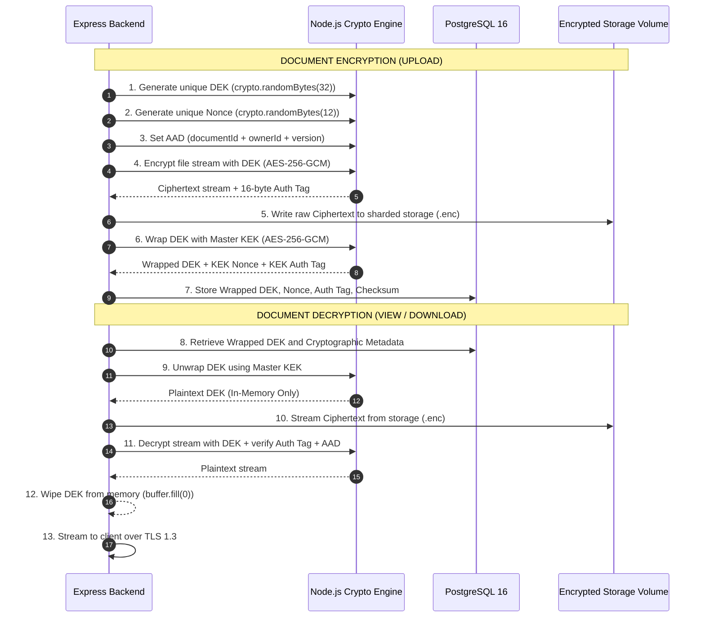

# MediVault AI — Encryption & Key Management Architecture

**Document Version:** 1.0.0  
**Specification:** AES-256-GCM Envelope Encryption & Cryptographic Lifecycle  
**Classification:** Medical Cryptographic Design  

---

## 1. Cryptographic Principles & Boundary Classification

MediVault AI handles sensitive Protected Health Information (PHI). To establish an honest and verifiable security posture, the encryption architecture clearly distinguishes between industry cryptographic paradigms:

```
┌──────────────────────────────────────────────────────────────────────────────────┐
│                            ENCRYPTION BOUNDARIES                                 │
├─────────────────────┬────────────────────────────────────────────────────────────┤
│ Encryption at Rest  │ Stored bytes on disk are unreadable without key.           │
│ (Implemented)       │ AES-256-GCM application envelope encryption.               │
├─────────────────────┼────────────────────────────────────────────────────────────┤
│ Encryption in Transit│ Network packets are protected between client & server.    │
│ (Implemented)       │ TLS 1.3 / HTTPS enforcing strong cipher suites.            │
├─────────────────────┼────────────────────────────────────────────────────────────┤
│ Application-Level   │ Backend controls encryption/decryption before storage.     │
│ (Implemented)       │ Protects against database dumps, disk theft, and leaks.    │
├─────────────────────┼────────────────────────────────────────────────────────────┤
│ End-to-End (E2EE)   │ Only the client can decrypt; server cannot read payload.   │
│ (Not Applicable)    │ Incompatible with planned Phase 2D server-side OCR/AI.     │
├─────────────────────┼────────────────────────────────────────────────────────────┤
│ Zero-Knowledge      │ Service provider has zero mathematical access to data.     │
│ (Explicitly Not)    │ MediVault AI DOES NOT claim zero-knowledge architecture.   │
└─────────────────────┴────────────────────────────────────────────────────────────┘
```

> [!IMPORTANT]
> **Honest Privacy Disclaimer:** MediVault AI implements **Application-Level Envelope Encryption (ALEE)**. The backend server manages decryption keys in memory upon authorized patient authentication. We explicitly do **not** claim "Zero-Knowledge" storage, because our planned Phase 2D medical intelligence engine requires authorized server-side access to parse laboratory markers and generate patient explanations with patient consent.

---

## 2. Authenticated Encryption Algorithm: AES-256-GCM

All document payloads are encrypted using **AES-256-GCM (Galois/Counter Mode)**, an industry-standard Authenticated Encryption with Associated Data (AEAD) cipher provided by Node.js native `crypto`.

### 2.1 Cryptographic Parameters
- **Cipher:** `aes-256-gcm`
- **Key Length:** 256 bits (32 bytes)
- **Initialization Vector (Nonce):** 96 bits (12 bytes) of cryptographically secure random bytes generated via `crypto.randomBytes(12)`.
- **Authentication Tag:** 128 bits (16 bytes) generated by GCM mode.
- **Additional Authenticated Data (AAD):** Cryptographic binding linking ciphertext to its context to prevent ciphertext transplant attacks.

### 2.2 Additional Authenticated Data (AAD) Binding
To prevent an attacker from copying an encrypted blob from Document A and swapping it into Document B, the encryption engine binds metadata to the ciphertext:

$$\text{AAD} = \text{documentId} \parallel \text{ownerId} \parallel \text{storageVersion}$$

During decryption, the same AAD must be provided to `decipher.setAAD()`. If an attacker relocates the encrypted blob to another document record, GCM authentication tag verification will immediately fail, rejecting the tampering.

---

## 3. Envelope Encryption Architecture

MediVault AI utilizes a **two-tier Envelope Encryption model**:
1. **Data Encryption Key (DEK):** A unique, ephemeral 256-bit AES key generated per document. Used solely to encrypt that specific document file.
2. **Key Encryption Key (KEK / Master Key):** A persistent 256-bit key used to encrypt (wrap) the document DEKs before storing them in PostgreSQL.



---

## 4. Key Storage Strategy: Local Development vs. Production

### 4.1 Local Development (Phase 2C & Capstone)
- **Master Key (`VAULT_MASTER_KEY`):**
  - Generated via `crypto.randomBytes(32).toString('hex')` (64-character hex string).
  - Stored in ignored local environment file (`backend/.env`).
  - Strict `.gitignore` enforcement prevents accidental commit to GitHub.
  - Development check: Backend halts on startup if `VAULT_MASTER_KEY` is undefined or under 32 bytes in length.

### 4.2 Production Enterprise Architecture (Future)
When deploying to cloud infrastructure, the Master KEK management transitions seamlessly:
- **AWS KMS / GCP Cloud KMS / HashiCorp Vault:**
  - The Master KEK never leaves the Hardware Security Module (HSM).
  - The backend calls KMS `GenerateDataKey` or `Encrypt`/`Decrypt` APIs over private VPC endpoints.
  - Role-based IAM policies restrict key usage exclusively to the backend production role.
  - Key usage creates an immutable CloudTrail / audit log for every decryption operation.

---

## 5. Cryptographic Metadata Schema

The database stores the exact metadata required to decrypt and verify the document, without ever exposing plaintext keys:

```prisma
model DocumentStorageMetadata {
  id                  String   @id @default(uuid())
  documentId          String   @unique
  encryptedDek        String   // Base64 encoded Wrapped DEK
  dekNonce            String   // Base64 encoded Nonce used to wrap DEK (12 bytes)
  dekAuthTag          String   // Base64 encoded Tag used to wrap DEK (16 bytes)
  fileNonce           String   // Base64 encoded Nonce used to encrypt file (12 bytes)
  fileAuthTag         String   // Base64 encoded Tag from file encryption (16 bytes)
  sha256Checksum      String   // SHA-256 digest of plaintext payload
  encryptionAlgorithm String   @default("AES-256-GCM")
  keyVersion          Int      @default(1)
  storageVersion      Int      @default(1)
  createdAt           DateTime @default(now())

  document MedicalDocument @relation(fields: [documentId], references: [id], onDelete: Cascade)

  @@map("document_storage_metadata")
}
```

---

## 6. Key Rotation Lifecycle

Envelope encryption provides immense security and operational benefits during key rotation:

### 6.1 Master KEK Rotation (Fast & Lightweight)
If the Master KEK is rotated (e.g. annually or following personnel change):
1. Load `OLD_MASTER_KEY` (version 1) and `NEW_MASTER_KEY` (version 2).
2. For each document in `DocumentStorageMetadata`:
   - Unwrap the DEK using `OLD_MASTER_KEY`.
   - Re-wrap the DEK using `NEW_MASTER_KEY`.
   - Update `encryptedDek`, `dekNonce`, `dekAuthTag`, and set `keyVersion = 2`.
3. **Crucial Security Benefit:** The large encrypted file payloads on disk are **not touched or re-encrypted**. Only small 32-byte keys in the database are re-encrypted, completing the rotation across thousands of documents in seconds.

### 6.2 Per-Document DEK Re-Encryption (Compromise Response)
If an individual document DEK is suspected of compromise:
1. Fetch encrypted blob from disk and decrypt using current DEK.
2. Generate fresh DEK and Nonce.
3. Re-encrypt payload and overwrite `.enc` file.
4. Update database metadata with new Wrapped DEK and Auth Tag.

---

## 7. Authentication Tag Verification & Error Handling

AES-GCM is an authenticated cipher. If even a single bit of the ciphertext, nonce, tag, or AAD has been tampered with or corrupted:
1. `decipher.final()` throws an explicit error: `Error: Unsupported state or unable to authenticate data`.
2. The decryption stream immediately aborts.
3. Partial plaintext chunks are purged from memory.
4. The system raises a high-priority security audit event (`DECRYPTION_AUTH_FAILED`).
5. The API returns HTTP `500 Internal Server Error` with a generic message: `"Document integrity verification failed"`.
6. Constant-time comparison (`crypto.timingSafeEqual`) is used whenever comparing token or tag hashes to prevent side-channel timing attacks.

---

## 8. Missing Key Disaster Recovery Scenarios

| Scenario | Impact | System Behavior & Recovery Runbook |
|---|---|---|
| **Lost Master KEK (`VAULT_MASTER_KEY`)** | Critical / Irreversible | All document blobs become mathematically irrecoverable. The backend enters an unrecoverable state. **Prevention:** KEK must be archived in offline cold storage (e.g. encrypted password manager / physical backup). |
| **Database Loss with Storage Intact** | Critical | If PostgreSQL metadata is lost without backup, the wrapped DEKs are lost. Files cannot be decrypted. **Rule:** Storage volume and PostgreSQL database must be backed up simultaneously. |
| **Corrupted File Blob on Disk** | Document Loss | GCM authentication tag verification fails. System reports corruption and refuses to serve malformed data. Restored from file backup. |
