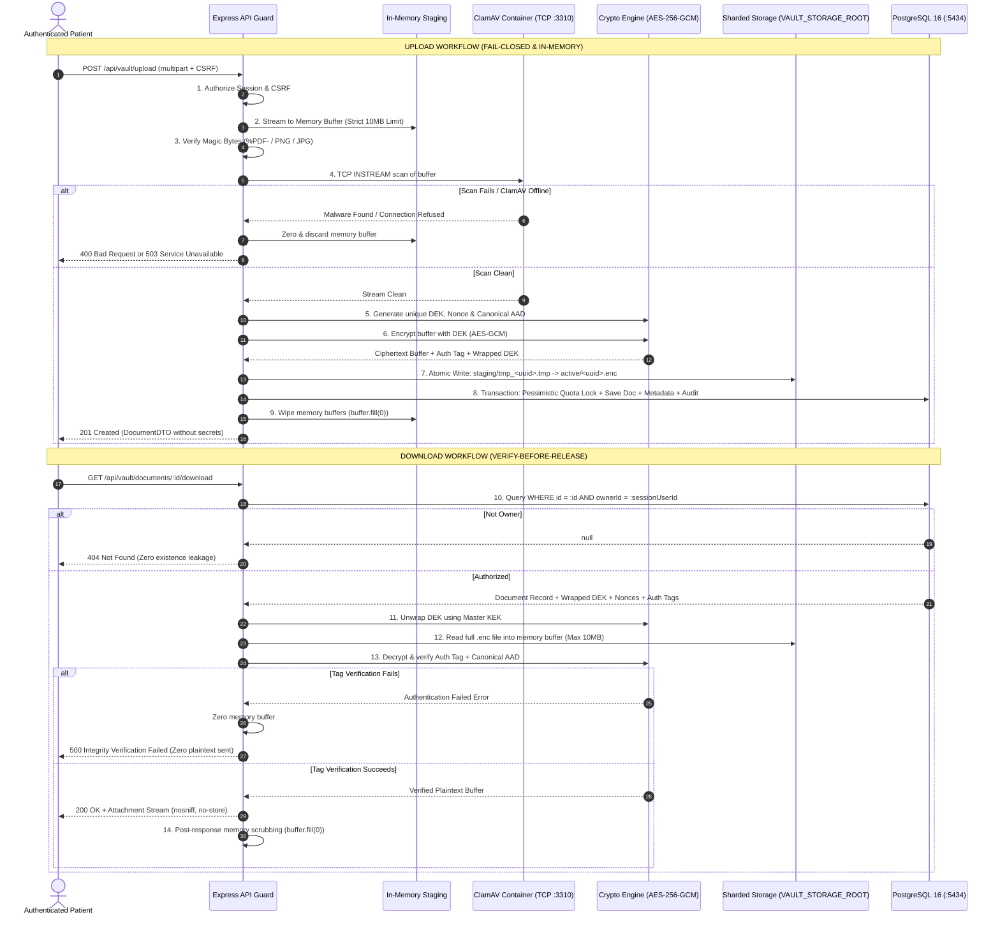

# MediVault AI — Phase 2C.2 Final Security Architecture Review

**Document Version:** 2.0.0  
**Phase:** Phase 2C.2 — Security Review & Architecture Corrections  
**Target Milestone:** Phase 2C.3 (Secure Upload Implementation)  
**Status:** Approved for Implementation Readiness (Analysis & Specifications Only)  
**Classification:** Medical Security & Cryptographic Review

---

## 1. Executive Summary & Review Verdict

This document formalizes the resolution of all architectural and cryptographic critiques raised during the Phase 2C.2 Security Review. The revised design addresses:

1. **Authenticated Decryption:** Eliminated streaming AES-GCM decryption; replaced with in-memory **Verify-Before-Release** ensuring authentication tags are 100% verified before any plaintext bytes reach the network.
2. **PDF Security:** Replaced naive keyword stripping with **safe attachment downloads** and **isolated sandboxed rendering** (null-origin iframe with disabled scripting).
3. **Backup Consistency:** Eliminated uncoordinated dumps; established a **quiesced manifest backup protocol** and automated reconciliation script.
4. **Key Management:** Enforced independent per-document 256-bit DEKs, 96-bit nonces, canonical AAD context binding, and envelope wrapping under Master KEK.
5. **Quarantine & Shredding:** Replaced persistent disk quarantine with **in-memory buffer staging** and TCP ClamAV streaming; defined **cryptographic shredding** as the true flash storage wipe guarantee.
6. **Runtime Environment Reality:** Grounded all pathing, storage, and permission designs in the actual runtime (Node.js v23 on Windows 11 host with PostgreSQL 16 Alpine in Docker Desktop).
7. **Storage Consistency:** Established atomic `.tmp` to `.enc` staging transitions, compensating rollbacks, and pessimistic quota locking.
8. **Test Cases:** Documented 12 comprehensive security verification tests operating on synthetic fixtures.

---

## 2. Matrix of Resolved Architecture Critiques

| Review Critique                         | Root Cause / Vulnerability                                                                                    | Architectural Correction Implemented                                                                                                                                        | Reference Document                                                                                    |
| --------------------------------------- | ------------------------------------------------------------------------------------------------------------- | --------------------------------------------------------------------------------------------------------------------------------------------------------------------------- | ----------------------------------------------------------------------------------------------------- |
| **1. Unsafe Streaming Decryption**      | AES-GCM plaintext was streamed to HTTP before `decipher.final()` verified the auth tag.                       | Implemented in-memory **Verify-Before-Release**: Decrypt full buffer (max 10MB), verify tag + AAD, and only then write to HTTP response. Concurrency capped at 5.           | [`ENCRYPTION_KEY_MANAGEMENT.md`](file:///f:/medivault%20AI/docs/ENCRYPTION_KEY_MANAGEMENT.md)         |
| **2. Flawed PDF Keyword Stripping**     | Regex/AST stripping of `/JavaScript` is bypassable via `/ObjStm` compression, hex encoding, or font exploits. | Replaced with **safe download-only** by default (`Content-Disposition: attachment; nosniff`) and isolated page rasterization / null-origin sandboxed PDF.js.                | [`SECURE_UPLOAD_SPEC.md`](file:///f:/medivault%20AI/docs/SECURE_UPLOAD_SPEC.md)                       |
| **3. Backup Desynchronization**         | Simultaneous `pg_dump` and `tar` capture different document sets over time intervals.                         | Implemented **quiesced manifest protocol**: System enters read-only mode; DB repeatable-read transaction exports exact active manifest; `tar` archives only manifest files. | [`DOCUMENT_BACKUP_RECOVERY.md`](file:///f:/medivault%20AI/docs/DOCUMENT_BACKUP_RECOVERY.md)           |
| **4. Raw DEK Exposure Risk**            | Raw DEKs must never be stored in plaintext.                                                                   | Implemented two-tier envelope encryption: Master KEK wraps DEK using AES-GCM with dedicated nonce and tag.                                                                  | [`ENCRYPTION_KEY_MANAGEMENT.md`](file:///f:/medivault%20AI/docs/ENCRYPTION_KEY_MANAGEMENT.md)         |
| **5. Plaintext Remnants on Disk**       | Temporary disk files leave plaintext on SSD flash blocks due to wear-leveling algorithms.                     | Ingestion and ClamAV scanning occur entirely in **memory buffers** via TCP `INSTREAM`. True data destruction achieved via **cryptographic shredding**.                      | [`SECURE_UPLOAD_SPEC.md`](file:///f:/medivault%20AI/docs/SECURE_UPLOAD_SPEC.md)                       |
| **6. Disconnected Runtime Assumptions** | Architecture assumed Linux containerized backend (`/var/lib/medivault`).                                      | Audited actual host: Node v23 on Windows 11 with Docker Postgres. Implemented configurable `VAULT_STORAGE_ROOT` and Windows-compatible pathing.                             | [`PHASE2C2_STORAGE_ARCHITECTURE.md`](file:///f:/medivault%20AI/docs/PHASE2C2_STORAGE_ARCHITECTURE.md) |
| **7. Quota Race Conditions**            | Concurrent uploads across tabs could bypass the 100MB patient quota.                                          | Implemented pessimistic row-level locking: `SELECT id FROM users WHERE id = :userId FOR UPDATE`.                                                                            | [`SECURE_UPLOAD_SPEC.md`](file:///f:/medivault%20AI/docs/SECURE_UPLOAD_SPEC.md)                       |

---

## 3. End-to-End System Sequence Diagram



---

## 4. Required Implementation Steps for Phase 2C.3

Implementation is organized into 6 testable milestones:

1. **Milestone 1 — Environment & Container Setup:**
   - Configure `VAULT_STORAGE_ROOT` in `backend/.env`.
   - Add ClamAV service to `docker-compose.yml` (`clamav/clamav:latest` bound to `127.0.0.1:3310`).
   - Create local directory hierarchy (`active/`, `deleted/`, `staging/`, `orphans/`).
2. **Milestone 2 — Database Schema Migration:**
   - Define `MedicalDocument`, `DocumentStorageMetadata`, `DocumentAuditEvent` in `schema.prisma`.
   - Execute version-controlled migration: `npm run migrate:dev`.
3. **Milestone 3 — Cryptographic Engine Implementation:**
   - Implement `wrapDek`, `unwrapDek`, `computeCanonicalAAD`, `encryptBufferAesGcm`, and `decryptBufferAesGcm`.
   - Implement in-process decryption semaphore (max 5 concurrent).
4. **Milestone 4 — In-Memory Upload Pipeline:**
   - Implement `busboy` streaming with 10 MB cap.
   - Implement `file-type` magic byte inspector.
   - Implement ClamAV TCP client with fail-closed error handling.
   - Implement pessimistic quota locking transaction.
5. **Milestone 5 — Verify-Before-Release Download & Preview Endpoints:**
   - Implement `GET /api/vault/documents/:id/download`.
   - Implement safe attachment headers.
   - Implement sandboxed inline preview renderer.
6. **Milestone 6 — Reconciliation & Backup Utilities:**
   - Implement `npm run vault:reconcile`.
   - Implement `npm run vault:backup`.

---

## 5. Mandatory Acceptance Criteria & Test Suite

Before Phase 2C.3 is certified for production or medical demonstration records, the following 12 test suites must pass:

```
[TEST-01] Authenticated Decryption Verification:
          Tampering with 1 byte of .enc file causes decipher.final() to throw.
          Assert HTTP 500 returned and 0 bytes of plaintext reach the client.

[TEST-02] Key Isolation & BOLA Defense:
          Patient A cannot fetch, download, or delete Patient B's document.
          Assert HTTP 404 Not Found (no 403 status code to prevent enumeration).

[TEST-03] Magic Byte vs. Spoofed Extension:
          Executable renamed to .pdf rejected with HTTP 415 Unsupported Media Type.

[TEST-04] Hard Size Enforcement:
          Stream exceeding 10 MB severed immediately with HTTP 413 Payload Too Large.

[TEST-05] Fail-Closed Malware Scanner:
          When ClamAV container is stopped, uploads return HTTP 503 Service Unavailable.
          Zero files are created in active/ or committed to PostgreSQL.

[TEST-06] In-Memory Plaintext Staging:
          Confirm no unencrypted files are created on disk during upload or scan.

[TEST-07] PDF Attachment Security:
          Assert download responses include Content-Disposition: attachment,
          X-Content-Type-Options: nosniff, and Cache-Control: no-store.

[TEST-08] Pessimistic Quota Serialization:
          Concurrent uploads attempting to exceed 100 MB quota are serialized
          and rejected with HTTP 400 Quota Exceeded.

[TEST-09] Compensating Rollback on DB Failure:
          Simulated database failure unlinks physical .enc file atomically.

[TEST-10] Master KEK Rotation Runbook:
          Re-wrapping utility updates all DEK records to keyVersion 2 without
          modifying physical .enc file blobs. Documents remain decryptable.

[TEST-11] Missing Master Key Failure Mode:
          Server fails to start if VAULT_MASTER_KEY is undefined or invalid.

[TEST-12] Manifest-Driven Backup & Restore:
          Execute backup while uploads occur. Restore backup to clean database
          and verify 100% manifest consistency via vault:reconcile.
```

---

## 6. Explicit Limitations of the Final-Year Prototype

To maintain academic and professional integrity, the following limitations are explicitly documented:

1. **Single-Node Storage:** Storage is bound to the local host filesystem. Multi-region redundancy or elastic auto-scaling requires migrating to cloud object storage (S3/GCS) in post-capstone phases.
2. **Key Storage:** Master KEK is managed via environment configuration rather than a physical Hardware Security Module (HSM).
3. **OCR/VLM Processing:** Document text extraction is strictly deferred to Phase 2D; uploaded files are stored safely as encrypted blobs without automated clinical parsing.
4. **Backup Erasure:** Permanent deletion applies immediately to live storage; complete eradication from rolling backup snapshots occurs over a 30-day snapshot expiration window.
