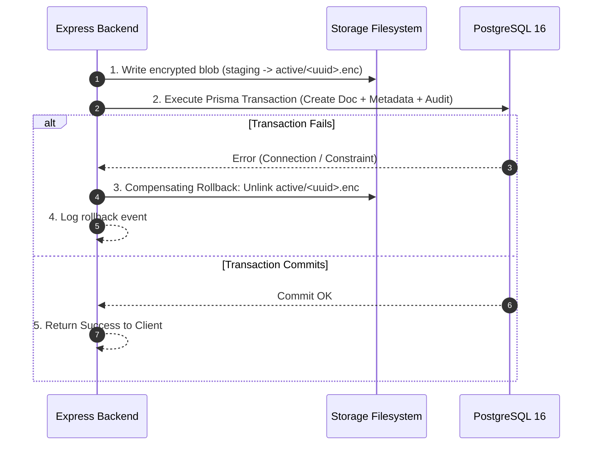

# MediVault AI — Phase 2C.2: Secure Document Storage Architecture (Revised)

**Document Version:** 2.0.0 (Post-Security Review Revisions)  
**Phase:** Phase 2C.2 — Architecture, Threat Modeling & Planning  
**Classification:** Confidential / System Architecture  
**Target Milestone:** Phase 2C.3 (Upload & Storage Engine Implementation)  

---

## 1. Executive Summary & Runtime Reality Grounding

MediVault AI is a privacy-first personal healthcare platform designed initially as a university capstone project and architected for enterprise production scalability. Medical documents—including laboratory panels, radiographs, prescriptions, and discharge summaries—represent **Protected Health Information (PHI)** and **Sensitive Personal Data (SPD)**.

### 1.1 Runtime Reality Check
An inspection of the active MediVault AI development environment identified the following concrete runtime topology:
- **Host Operating System:** Windows 11 (x64).
- **Backend Runtime:** Node.js v23.9.0 running **natively on the Windows host** (not inside a Docker container).
- **Database Engine:** PostgreSQL 16 Alpine running inside Docker Desktop (`medivault-postgres` container bound strictly to `127.0.0.1:5434`).
- **Frontend Runtime:** React 19 + Vite running natively on Windows host (`localhost:5173`).

> [!IMPORTANT]
> **Filesystem & Permission Reality:** On Windows, Linux-style POSIX permissions (`chmod 0700` / `0600`) do not exist; Node's `fs.chmod` on Windows only toggles file read-only attributes. Therefore, in the local development environment, access control relies on:
> 1. Locating the storage directory strictly outside web server roots and workspace source folders (`VAULT_STORAGE_ROOT`).
> 2. Zero static file serving handlers in Express.
> 3. Strict application-layer access enforcement.
> When containerized in production (Linux), POSIX `0700`/`0600` permissions and Docker named volumes (`medivault_vault_data`) provide the operating-system-level boundary.

---

## 2. Storage Architecture: Local Development vs. Production

### 2.1 Storage Path Configuration
The storage root is fully decoupled via environment configuration:
- **Development (Windows):** Configured via `VAULT_STORAGE_ROOT` in `backend/.env`, resolving to a dedicated local directory:
  `f:\medivault AI\storage_vault\` (added to `.gitignore`).
- **Production (Containerized Linux):** Configured to a dedicated volume mount:
  `/var/lib/medivault/storage/` mounted from named Docker volume `medivault_vault_data`.

### 2.2 Directory Hierarchy & Inode Sharding

To prevent filesystem bottlenecks and directory entry limits on filesystems, files are organized using **two-level two-character hexadecimal sharding** derived from the random document UUIDv4.

```
<VAULT_STORAGE_ROOT>/
├── active/                                  [Encrypted active documents]
│   ├── 4f/
│   │   └── 7a/
│   │       └── 4f7ac10b-58cc-4372-a567-0e02b2c3d479.enc
│   └── a1/
│       └── c3/
│           └── a1c3f90e-12bb-4122-8901-7fa11c2b5589.enc
├── deleted/                                 [Soft-deleted tombstone storage]
│   └── 4f/
│       └── 7a/
│           └── 4f7ac10b-58cc-4372-a567-0e02b2c3d479.tombstone
└── staging/                                 [Temporary atomic staging]
    └── tmp_4f7ac10b-58cc-4372-a567-0e02b2c3d479.enc.tmp
```

*Note on Quarantine:* As corrected in Security Review item 5, plaintext quarantine files are **never written to persistent disk** during upload; quarantine validation and ClamAV scanning occur in **memory-bounded buffers** (or RAM disk).

---

## 3. Storage Service Architecture & Interface

All file storage operations implement the `IStorageService` interface, isolating file I/O from Express route handlers:

```typescript
export interface StoredFileResult {
  storageKey: string;
  byteSize: number;
  sha256Checksum: string;
}

export interface IStorageService {
  /**
   * Atomically writes an encrypted buffer to sharded storage.
   * Writes to staging/<storageKey>.tmp, then atomically renames to active/<shard>/<storageKey>.enc.
   */
  writeEncryptedBlob(storageKey: string, encryptedData: Buffer): Promise<StoredFileResult>;

  /**
   * Reads the full encrypted blob into memory for authenticated decryption.
   * Enforces 10 MB maximum buffer size.
   */
  readEncryptedBlob(storageKey: string): Promise<Buffer>;

  /**
   * Moves an active file to the tombstoned deletion directory.
   */
  tombstoneBlob(storageKey: string): Promise<void>;

  /**
   * Restores a tombstoned file back to active storage.
   */
  restoreTombstoneBlob(storageKey: string): Promise<void>;

  /**
   * Permanently unlinks an encrypted file from disk (hard purge).
   */
  purgeBlob(storageKey: string): Promise<void>;

  /**
   * Checks if an encrypted blob exists on disk.
   */
  blobExists(storageKey: string): Promise<boolean>;

  /**
   * Reconciles physical files on disk against a list of expected storage keys.
   */
  reconcileStorage(activeKeys: Set<string>): Promise<{ orphaned: string[]; missing: string[] }>;
}
```

---

## 4. End-to-End System Component Diagram

```mermaid
flowchart TD
    Client["Patient Web Client (React 19)"]
    
    subgraph Host["Host Operating System (Windows Dev / Linux Prod)"]
        subgraph BackendProcess["Node.js Express Backend (:5000)"]
            AuthGuard["Session & Auth Guard (HttpOnly Cookie)"]
            CSRFGuard["CSRF Double-Submit Validator"]
            OwnerGuard["Server-Side Ownership Validator"]
            MemStaging["In-Memory Upload Buffer (Max 10MB)"]
            SigValidator["Magic Byte File Signature Validator"]
            Sanitizer["Image EXIF Stripper (Sharp)"]
            DecEngine["In-Memory Authenticated Decryptor (AES-GCM)"]
            EncEngine["AES-256-GCM Envelope Encryption Engine"]
        end
        
        subgraph DockerServices["Docker Desktop Containers"]
            DB[("PostgreSQL 16 Alpine (:5434)\nMetadata, Wrapped DEKs & Audit Logs")]
            ClamAV["ClamAV Daemon (:3310)\nLocal Antivirus Screening (INSTREAM)"]
        end
        
        subgraph FileStorage["Storage Root (VAULT_STORAGE_ROOT)"]
            ActiveDir[("Active Sharded Blobs\nactive/xx/yy/[uuid].enc")]
            TombstoneDir[("Deleted Tombstone Blobs\ndeleted/xx/yy/[uuid].tombstone")]
            StagingDir[("Atomic Write Staging\nstaging/tmp_[uuid].enc.tmp")]
        end
    end
    
    Client -->|1. Multipart Upload (HTTPS)| AuthGuard
    AuthGuard --> CSRFGuard
    CSRFGuard --> MemStaging
    MemStaging -->|2. Validate Magic Bytes| SigValidator
    SigValidator -->|3. TCP INSTREAM Scan| ClamAV
    ClamAV -->|4. Clean Stream| Sanitizer
    Sanitizer -->|5. Envelope Encrypt| EncEngine
    EncEngine -->|6. Atomic Write .tmp -> .enc| StagingDir
    StagingDir -->|7. Move to Shard| ActiveDir
    EncEngine -->|8. Store Wrapped DEK & Nonce| DB
    
    Client -->|9. Authenticated View/Download| OwnerGuard
    OwnerGuard -->|10. Check Ownership| DB
    DB -->|11. Fetch Wrapped DEK & Nonce| DecEngine
    ActiveDir -->|12. Read Full Ciphertext Buffer| DecEngine
    DecEngine -->|13. Complete Tag Verification in Memory| DecEngine
    DecEngine -->|14. Send Plaintext Buffer Only After Auth Success| Client
```

---

## 5. Storage Consistency & Failure Recovery

### 5.1 Atomic Writes via Staging Files
To prevent partially written or truncated files from ever appearing in the active vault:
1. All encrypted writes write to `<VAULT_STORAGE_ROOT>/staging/tmp_<uuid>.enc.tmp`.
2. Once the write completes and the SHA-256 checksum is computed, the file is atomically renamed (`fs.promises.rename`) to the destination shard:
   `<VAULT_STORAGE_ROOT>/active/xx/yy/<uuid>.enc`.
3. Node.js `fs.rename` is an atomic filesystem operation on the same volume.

### 5.2 Two-Phase Storage-Database Coordination


### 5.3 Periodic Reconciliation Worker (`vault:reconcile`)
An automated administrative reconciliation script runs during system maintenance:
1. Queries all active `storageKey` entries from `MedicalDocument WHERE deletedAt IS NULL`.
2. Scans `<VAULT_STORAGE_ROOT>/active/` for physical files.
3. **Orphaned Files (on disk but not in DB):** Moved to `/storage/vault/orphans/` for review and deletion after 14 days.
4. **Missing Files (in DB but not on disk):** Document status updated to `REJECTED`, alerting administrators.
