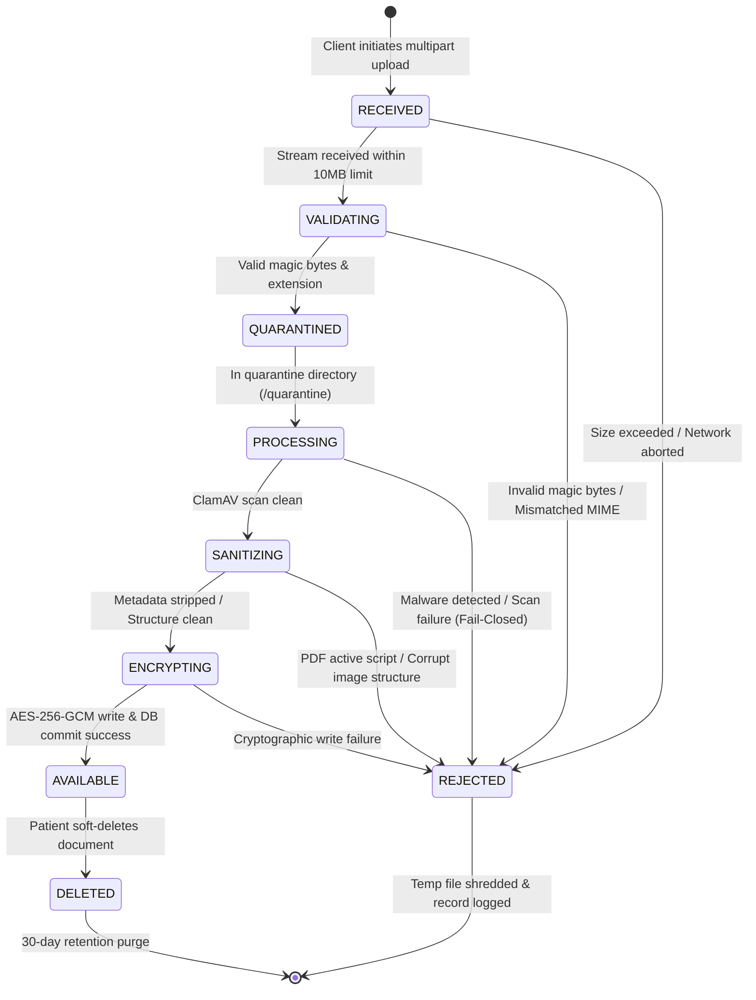
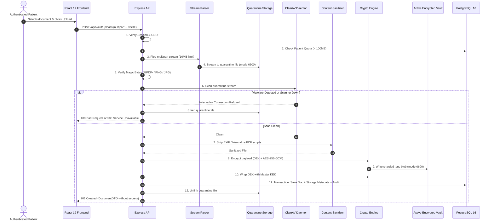

# MediVault AI — Secure Upload Pipeline Specification

**Document Version:** 1.0.0  
**Phase:** Phase 2C.2 Architecture & Planning  
**Target Implementation:** Phase 2C.3  
**Classification:** Core Security Engineering Specification  

---

## 1. Objective & Scope

This specification defines the multi-stage, fail-closed upload pipeline for medical documents in MediVault AI. 

### Mandatory Guarantees:
1. **Never Trust Client Metadata:** User-supplied file names, extensions, and `Content-Type` headers are treated as untrusted and potentially hostile.
2. **Fail-Closed Malware Guard:** A file is never marked `AVAILABLE` or served to a patient unless it passes cryptographic validation, structural inspection, and antivirus scanning.
3. **No Execution Surface:** Files are stored encrypted outside public web roots with POSIX permissions `0600`.
4. **Zero Lingering Plaintext:** Interrupted uploads, validation rejections, and intermediate staging files are atomically unlinked and scrubbed.

---

## 2. Ingestion Constraints & Allowlist

| Attribute | Specification | Enforcement Mechanism |
|---|---|---|
| **Supported Formats** | PDF (`application/pdf`), PNG (`image/png`), JPG/JPEG (`image/jpeg`) | Magic byte signature verification via `file-type`. |
| **Forbidden Formats** | Executables, scripts, HTML, SVG, ZIP/archives, office docs, audio/video | Strict extension and magic byte deny-by-default. |
| **Max File Size** | $10\text{ MB}$ ($10,485,760\text{ bytes}$) per document | Stream byte counter in `busboy` parser. |
| **Per-Patient Storage Quota** | $100\text{ MB}$ or 10 documents (Local FYP limit) | Database aggregation check prior to upload acceptance. |
| **Rate Limit** | 5 uploads per minute per authenticated IP/session | Sliding window rate limiter middleware. |

---

## 3. Upload State Machine

Every medical document transitions through a deterministic state machine managed in PostgreSQL:



### State Definitions:
- **`RECEIVED`:** Multipart stream accepted; temporary staging file allocated in quarantine.
- **`VALIDATING`:** Inspecting file signature magic bytes, MIME type, and extension canonicalization.
- **`QUARANTINED`:** File passed initial validation; staged in isolated `/storage/vault/quarantine/` awaiting malware inspection.
- **`AVAILABLE`:** Fully sanitized, envelope-encrypted, committed to PostgreSQL, and ready for patient viewing.
- **`REJECTED`:** Failed validation, contained malware, or scanner was offline. Staging file is immediately shredded.
- **`DELETED`:** Marked soft-deleted (`deletedAt` populated) and moved to tombstone storage.

---

## 4. Multi-Stage Pipeline Breakdown

### Stage 1: Pre-Flight Authorization & Quota Check
1. Validate active session cookie (`req.user` populated).
2. Validate CSRF header (`X-CSRF-Token`).
3. Query database:
   $$\sum \text{fileSize} \le 100\text{ MB} \quad \text{and} \quad \text{count(documents)} < 10$$
   If quota exceeded, abort immediately with HTTP `400 Bad Request`.

### Stage 2: Streaming Ingestion & Hard Size Enforcement
1. Use `busboy` streaming parser with `limits: { fileSize: 10485760, files: 1 }`.
2. Generate temporary quarantine file identifier: `q_[UUIDv4].tmp`.
3. Pipe incoming stream directly to `/var/lib/medivault/storage/quarantine/q_[UUIDv4].tmp` with permissions `0600`.
4. If byte count exceeds 10 MB, `busboy` triggers `limit` event:
   - Immediately abort writable stream.
   - Unlink partial file.
   - Return HTTP `413 Payload Too Large`.

### Stage 3: Magic Byte & File Signature Verification
1. Read the first 4,100 bytes from the quarantine file using `file-type`.
2. Determine true MIME type from file headers:
   - PDF: `%PDF-` (`0x25 0x50 0x44 0x46 0x2D`)
   - PNG: `\x89PNG\r\n\x1a\n` (`0x89 0x50 0x4E 0x47 0x0D 0x0A 0x1A 0x0A`)
   - JPEG: `\xFF\xD8\xFF`
3. Compare detected MIME type against allowed list. **Reject any file whose magic bytes do not match allowed formats**, regardless of filename extension.

### Stage 4: Filename Sanitization & Canonicalization
1. Extract original filename extension:
   ```typescript
   const cleanExtension = path.extname(untrustedFilename).toLowerCase();
   ```
2. Validate extension against allowlist: `['.pdf', '.png', '.jpg', '.jpeg']`.
3. Ensure single extension (no hidden double extensions like `report.exe.pdf`).
4. Sanitize original filename for display:
   ```typescript
   const safeDisplayName = untrustedFilename
     .replace(/[^a-zA-Z0-9._-]/g, '_')
     .substring(0, 120);
   ```

### Stage 5: Malware Inspection (ClamAV Fail-Closed)
1. Stream file to local ClamAV daemon socket (`/var/run/clamav/clamd.ctl` or TCP `clamav:3310`).
2. **Fail-Closed Architecture:**
   ```typescript
   try {
     const scanResult = await clamavScanner.scanFile(quarantinePath);
     if (scanResult.isInfected) {
       await shredFile(quarantinePath);
       await recordAuditEvent('UPLOAD_MALWARE_BLOCKED', { virus: scanResult.virusName });
       throw new AppError('File rejected: Malicious content detected', 400);
     }
   } catch (err) {
     if (err.isClamAvConnectionError) {
       // SCANNER OFFLINE: MUST FAIL CLOSED
       await shredFile(quarantinePath);
       await recordAuditEvent('UPLOAD_SCANNER_OFFLINE_ABORT');
       throw new AppError('Service temporarily unavailable: Security inspection offline', 503);
     }
     throw err;
   }
   ```

### Stage 6: Content Sanitization & Metadata Stripping
1. **For Images (PNG / JPEG):**
   - Process using `sharp`:
     ```typescript
     await sharp(quarantinePath)
       .rotate() // Auto-orient based on EXIF before stripping
       .toFile(sanitizedPath); // Re-encoding automatically strips all EXIF/XMP/IPTC
     ```
   - Validates maximum pixel bounds ($8000 \times 8000$) to defeat pixel-flood memory bombs.
2. **For PDFs:**
   - Scan binary structure for dangerous dictionary keys: `/JavaScript`, `/JS`, `/Launch`, `/EmbeddedFiles`, `/URI`.
   - If interactive or active elements are detected, reject the document or strip objects prior to storage.

### Stage 7: Envelope Encryption & Sharded Storage
1. Generate unique 32-byte DEK and 12-byte Nonce.
2. Construct AAD: `documentId + ownerId + storageVersion`.
3. Read sanitized quarantine file stream; pipe through `crypto.createCipheriv('aes-256-gcm', dek, nonce, { authTagLength: 16 })`.
4. Compute SHA-256 checksum simultaneously using `crypto.createHash('sha256')`.
5. Stream encrypted ciphertext directly to sharded storage path:
   `/var/lib/medivault/storage/active/xx/yy/[UUIDv4].enc` (mode `0600`).
6. Retrieve 16-byte Auth Tag from cipher.
7. Wrap DEK using Master KEK:
   `wrappedDek = encryptAesGcm(dek, MASTER_KEK)`.

### Stage 8: Atomic Database Commit & Quarantine Shredding
1. Execute Prisma transaction:
   - Create `MedicalDocument` (status: `AVAILABLE`).
   - Create `DocumentStorageMetadata` (wrapped DEK, nonces, auth tags, checksum).
   - Create `DocumentAuditEvent` (action: `DOCUMENT_UPLOADED`).
2. Upon successful transaction commit:
   - Unlink quarantine file (`fs.unlink`).
3. If database transaction fails:
   - Unlink `.enc` file from active storage (compensating rollback).
   - Unlink quarantine file.
   - Throw error.

---

## 5. End-to-End Sequence Diagram


