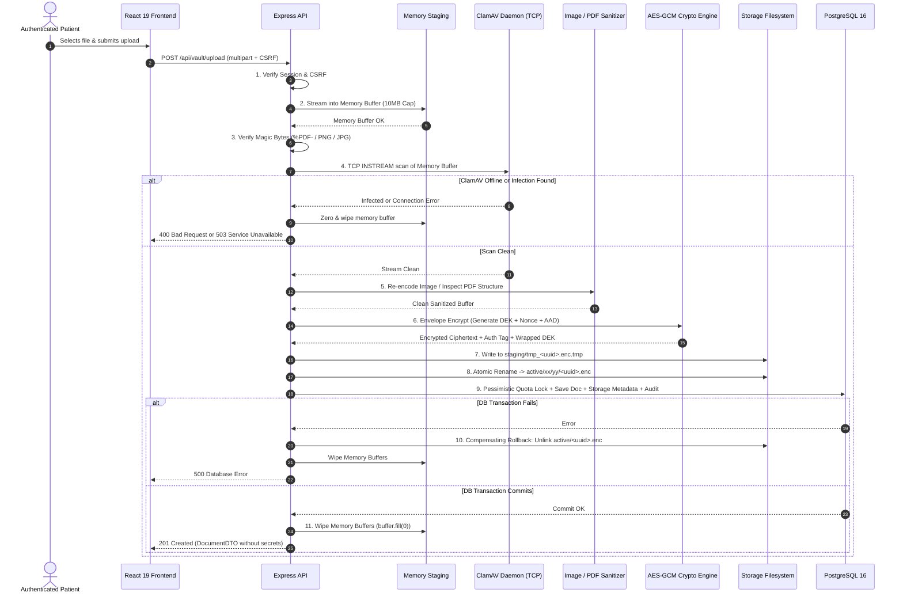

# MediVault AI — Secure Upload Pipeline Specification (Revised)

**Document Version:** 2.0.0 (Post-Security Review Revisions)  
**Phase:** Phase 2C.2 Architecture & Planning  
**Target Milestone:** Phase 2C.3 (Implementation)  
**Classification:** Core Security Engineering Specification  

---

## 1. Objective & Architectural Guarantees

This specification defines the multi-stage, fail-closed medical document upload pipeline for MediVault AI. 

### Mandatory Guarantees:
1. **Never Trust Client Metadata:** User-supplied file names, extensions, and `Content-Type` headers are treated as untrusted and potentially hostile.
2. **Zero Persistent Plaintext (In-Memory Quarantine):** Upload streams under the 10 MB limit are validated, scanned, and encrypted **in memory** (or inside RAM-backed storage). No plaintext patient document files are ever written to persistent host disk sectors.
3. **Fail-Closed Antivirus Screening:** If the ClamAV scanning daemon is unreachable, offline, or returns an error, the file is rejected immediately (HTTP 503). Zero unscanned documents are ever marked `AVAILABLE`.
4. **Pessimistic Quota Locking:** Storage quota checks use pessimistic database row-locks (`SELECT ... FOR UPDATE`) to prevent concurrent upload quota race conditions.
5. **Atomic Storage Transitions:** Encrypted files write to `.tmp` files first, atomically renaming to `.enc` only upon successful cipher finalization and database commit.

---

## 2. Ingestion Constraints & Rules

| Parameter | Specification | Enforcement Mechanism |
|---|---|---|
| **Max File Size** | $10\text{ MB}$ ($10,485,760\text{ bytes}$) per document | Stream byte counter in `busboy` parser; hard disconnect if exceeded. |
| **Allowed File Types** | PDF (`application/pdf`), PNG (`image/png`), JPG/JPEG (`image/jpeg`) | Magic byte file signature inspection via `file-type` header check. |
| **Forbidden Types** | Executables, scripts, HTML, SVG, ZIP/archives, Office formats | Deny-by-default on all unrecognized magic bytes. |
| **Patient Storage Quota** | $100\text{ MB}$ total cumulative storage per patient | Pessimistic database lock check before stream acceptance. |
| **Rate Limit** | 5 uploads per minute per authenticated IP/session | Express sliding-window rate limiter middleware. |

---

## 3. Redesigned In-Memory Quarantine & Malware Scanning

### 3.1 Why Persistent Disk Quarantine Was Replaced
Traditional disk quarantine writes unencrypted files to `/storage/quarantine/` before scanning. On modern solid-state drives (SSDs) and journaling filesystems:
- Flash translation layers (FTL) employ wear-leveling algorithms.
- Unlinking (`fs.unlink`) or standard file overwriting does **not** guarantee physical erasure of flash NAND cells. Plaintext patient data can remain forensic recoverable from unallocated clusters.

### 3.2 In-Memory Staging Architecture
Because documents are strictly bounded to 10 MB, the upload pipeline utilizes **In-Memory Buffer Quarantine**:
1. `busboy` streams the upload directly into an in-memory `Buffer`.
2. Memory buffer byte limit is strictly enforced (rejects and destroys stream if $> 10\text{ MB}$).
3. **ClamAV Streaming Scan (TCP INSTREAM):**
   The backend connects to the ClamAV daemon running in Docker via TCP (`127.0.0.1:3310` on dev, `clamav:3310` in prod):
   - The backend issues the ClamAV `zINSTREAM\0` protocol command.
   - The memory buffer is streamed in binary chunks over the TCP socket.
   - ClamAV scans the stream in memory and returns `stream: OK` or `stream: <VirusName> FOUND`.
   - **Zero plaintext files are written to physical disk sectors.**

### 3.3 Fail-Closed Scanner Behavior
```typescript
async function scanBufferWithClamAV(fileBuffer: Buffer): Promise<void> {
  let socket: net.Socket;
  try {
    socket = net.connect({ host: env.CLAMAV_HOST, port: env.CLAMAV_PORT });
  } catch (err) {
    // SCANNER UNREACHABLE: FAIL CLOSED
    await recordAuditEvent('UPLOAD_SCANNER_OFFLINE', { error: String(err) });
    throw new AppError('Security scanning service is offline. Upload aborted.', 503);
  }

  // Stream chunks via clamd INSTREAM protocol...
  // If response contains "FOUND": throw AppError('Malicious content detected', 400);
}
```

---

## 4. Redesigned PDF Security Architecture

### 4.1 Rejection of Naive Keyword Stripping
The previous draft suggested stripping `/JavaScript` or `/Launch` keywords from PDF byte streams. **This approach was rejected as insecure**:
- The PDF ISO specification allows object streams (`/ObjStm`), hexadecimal name obfuscation (`/Java#53cript`), and cross-reference table manipulations that easily evade naive regex/AST token stripping.
- Attempting to sanitize raw PDF binary streams risks corrupting legitimate medical reports or creating a false sense of security.

### 4.2 Comprehensive Multi-Tier PDF Security Controls

```
┌──────────────────────────────────────────────────────────────────────────────────┐
│                           PDF SECURITY ARCHITECTURE                              │
├─────────────────────┬────────────────────────────────────────────────────────────┤
│ 1. Ingestion        │ PDF structural validation: parse xref table, verify        │
│    Validation       │ standard compliance, reject corrupted/malformed objects.   │
├─────────────────────┼────────────────────────────────────────────────────────────┤
│ 2. Primary Delivery │ Safe Download-Only by default:                             │
│    (Downloads)      │ Content-Disposition: attachment; filename="sanitized.pdf"  │
│                     │ X-Content-Type-Options: nosniff                            │
├─────────────────────┼────────────────────────────────────────────────────────────┤
│ 3. Inline Preview   │ Option A (Recommended): Server-side page rasterization     │
│    Architecture     │ into inert PNG images via isolated worker.                 │
│                     │ Option B: Hardened PDF.js in sandboxed iframe (null origin)│
│                     │ with enableScripting: false, isEvalSupported: false.       │
└─────────────────────┴────────────────────────────────────────────────────────────┘
```

1. **Safe Download-Only Enforcement:**
   When a patient clicks "Download", the response forces attachment download with explicit headers:
   ```http
   Content-Type: application/pdf
   Content-Disposition: attachment; filename="Blood_Test_Report_20261028.pdf"
   X-Content-Type-Options: nosniff
   Cache-Control: private, no-store, max-age=0, must-revalidate
   ```
2. **Safe Inline Preview Engine (Two Approved Modes):**
   - **Mode A (Highest Isolation — Recommended): Server-Side Page Rasterization:**
     The backend renders the PDF into static PNG page images using an isolated worker. The browser only receives PNG images (`/preview?page=1`). This **completely eliminates** browser PDF parser attack surfaces.
   - **Mode B (Client-Side Sandboxed PDF.js):**
     If vector PDF viewing is needed, the frontend mounts an isolated viewer inside an `<iframe>`:
     - `sandbox="allow-scripts"` (to execute PDF.js itself).
     - `sandbox="allow-same-origin"` is **strictly omitted** (gives iframe a `null` origin, making it impossible to read MediVault session cookies, local storage, or API endpoints).
     - PDF.js configuration: `enableScripting: false` (strictly disables embedded PDF JS actions).

---

## 5. Image Sanitization & EXIF Stripping

All uploaded images (PNG, JPEG) are processed using `sharp`:
1. **Dimension Validation:** Image pixel dimensions must not exceed $8,000 \times 8,000$ pixels (prevents pixel-flood memory bombs).
2. **Re-encoding:** Images are re-encoded from raw pixel buffers:
   ```typescript
   const sanitizedBuffer = await sharp(rawBuffer)
     .rotate() // Corrects orientation before stripping
     .toFormat(detectedFormat, { quality: 90 }) // Strips all EXIF, XMP, IPTC
     .toBuffer();
   ```
3. Polyglot payloads (e.g. PHP/JS embedded in EXIF comment blocks) are destroyed during re-encoding.

---

## 6. Storage Consistency & Pessimistic Quota Locking

To prevent race conditions where two simultaneous uploads exceed the 100 MB quota:

```typescript
// Execute inside a Prisma transaction with a row-level lock on the User record
await prisma.$transaction(async (tx) => {
  // 1. Lock user row to serialize concurrent uploads
  await tx.$executeRaw`SELECT id FROM users WHERE id = ${userId} FOR UPDATE`;

  // 2. Compute current cumulative storage
  const stats = await tx.medicalDocument.aggregate({
    where: { ownerId: userId, deletedAt: null },
    _sum: { fileSize: true },
    _count: { id: true },
  });

  const currentUsage = stats._sum.fileSize || 0;
  const currentCount = stats._count.id || 0;

  if (currentUsage + newFileSize > 100 * 1024 * 1024) {
    throw new AppError('Storage quota exceeded (100 MB limit)', 400);
  }

  if (currentCount >= 10) {
    throw new AppError('Document count limit reached (10 documents limit)', 400);
  }

  // 3. Atomically insert document record
  const doc = await tx.medicalDocument.create({ ... });
  await tx.documentStorageMetadata.create({ ... });
  await tx.documentAuditEvent.create({ ... });
});
```

---

## 7. Complete End-to-End Upload Sequence Diagram


